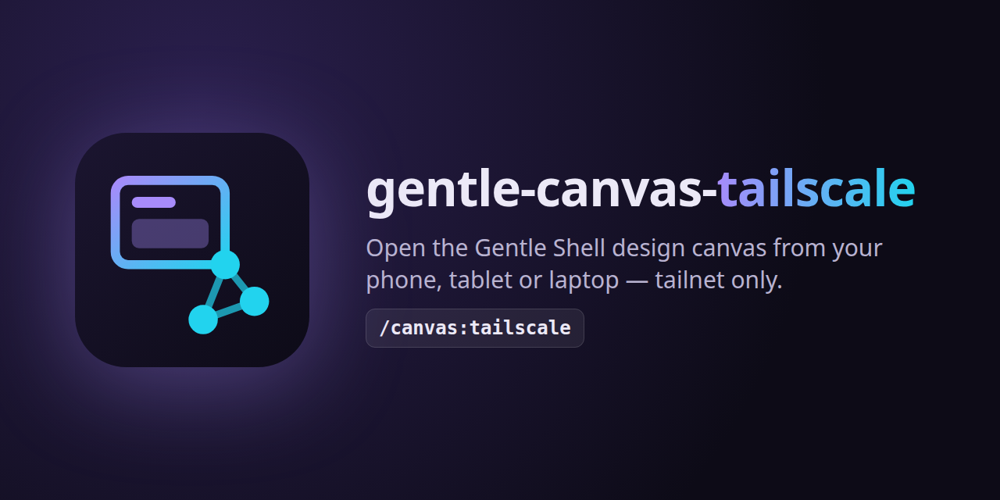

<p align="center"></p>

<p align="center"><a href="README.md">English</a> · <b>Español</b></p>

# gentle-canvas-tailscale

Abre el **canvas de diseño** de [Gentle Shell](https://gentlemanprogramming.com/gentle-hub/) (`gentle_design` / `/gentle:design`) desde tu teléfono, tablet u otra laptop, **solo dentro de tu tailnet de Tailscale**.

> **Solución provisoria.** Hoy el canvas solo acepta solicitudes desde loopback. Cuando Gentle Shell soporte el acceso remoto al canvas de forma nativa, desinstala esta extensión.

## Por qué hace falta

El canvas escucha en `127.0.0.1` con un puerto y un token de URL aleatorios en cada inicio, y rechaza toda solicitud cuyo `Host` u `Origin` no sea su propio origen loopback. Apuntar `tailscale serve` directamente a él falla por dos motivos: el puerto cambia y el canvas responde `421 misdirected` / `403 forbidden`.

Esta extensión ejecuta un pequeño proxy en loopback que:

1. **Encuentra el canvas por sí solo.** El token viaja en cada ruta de la URL, así que el proxy prueba tus propios listeners de loopback con `GET /<token>/` y acepta solo la página que contiene ese token. Nunca elige otra app que responda a cualquier ruta, ni otra copia de sí mismo.
2. **Habla el idioma del canvas.** Reescribe `Host` y `Origin` al origen loopback del canvas, elimina `Referer` y agrega tu origen de la tailnet a los `frame-ancestors` de los artboards, para que funcionen los artboards, los comentarios y las actualizaciones en vivo (SSE).

El token sigue siendo obligatorio: alguien en tu tailnet sin la URL vigente recibe `502`.

## Instalación

```bash
pi install git:github.com/BlazzzPlay/gentle-canvas-tailscale
```

Requisitos: Pi con Gentle Shell (gentle-design), Node.js 22+, Linux (se usa `ss` para listar tus listeners de loopback) y Tailscale con sesión iniciada en la máquina donde corre Pi.

## Configuración inicial (una sola vez)

Asigna un puerto HTTPS de la tailnet al proxy (por defecto `34316`):

```bash
tailscale serve --bg --https=8450 http://127.0.0.1:34316
```

`/canvas:tailscale` muestra exactamente este comando si falta la asignación.

## Uso

```text
/canvas:tailscale          inicia el proxy (igual que: /canvas:tailscale start)
/canvas:tailscale status   muestra el estado del proxy y la URL actual de la tailnet
/canvas:tailscale stop     detiene el proxy
```

Luego abre un diseño (`gentle_design open` o `/gentle:design`). La extensión inicia el proxy si todavía no está corriendo e informa ambas direcciones a la vez: `/gentle:design` las muestra en pantalla y `gentle_design open` las agrega al resultado de la herramienta para que el agente te las pase. Por ejemplo:

```text
Canvas local: http://127.0.0.1:<port>/<token>/d/<design>/
Canvas on your tailnet: https://my-box.my-tailnet.ts.net:8450/<token>/d/<design>/
```

`/gentle:design` comparte su URL solo a través de su aviso en pantalla, así que la extensión observa los avisos que muestra Pi (lee `Design canvas: <loopback url>` y deja pasar cada aviso sin cambios).

El proxy se detiene junto con la sesión de Pi. Cuando el canvas se reinicia, su token cambia: abre el diseño de nuevo para obtener la URL nueva. No hace falta reiniciar el proxy.

### Configuración

| Variable | Valor por defecto | Significado |
| --- | --- | --- |
| `GENTLE_CANVAS_TAILSCALE_PROXY_PORT` | `34316` | Puerto loopback del proxy (el destino de `tailscale serve`) |
| `GENTLE_CANVAS_TAILSCALE_PUBLIC_PORT` | `8450` | Puerto HTTPS de la tailnet sugerido en el comando de configuración |

El nombre de host de la tailnet se lee de `tailscale status --json`; el origen público es el que `tailscale serve` asigne al puerto del proxy.

## Seguridad

- **Solo tailnet.** El proxy omite a propósito la protección de mismo origen del canvas para tu tailnet. La extensión **se niega a iniciar** cuando `tailscale funnel` expone el proxy a internet (mediante cualquier entrada de serve, handler de ruta o reenvío TCP que llegue a él), y mientras corre vuelve a verificar cada 15 segundos y **detiene el proxy** si funnel se activa después. Nunca lo pongas detrás de funnel ni de ningún túnel público.
- El descubrimiento solo prueba tus propios listeners de loopback, y solo con el token de la ruta de la solicitud; un cliente de la tailnet que envíe tokens inventados no obtiene nada más que un `502`.
- El proxy escucha solo en `127.0.0.1` y nunca cambia tu configuración de Tailscale; solo lee `tailscale status` y `tailscale serve status`.
- Cualquier persona en tu tailnet que tenga la URL vigente (con su token) puede ver y comentar tus diseños, igual que en tu propia máquina.

## Limitaciones

- La vista **Compare** del canvas incrusta tu app en ejecución desde `http://localhost:<port>`; los navegadores bloquean eso desde una página `https` de la tailnet.
- Por ahora solo Linux (el listado de puertos usa `ss`).

## Desarrollo

```bash
npm test   # node --test, sin dependencias
```

## Hecho con Gentle-AI

<div align="center">

<a href="https://github.com/Gentleman-Programming/gentle-ai">
  
</a>

</div>

## Licencia

[MIT](LICENSE) © 2026 Fabian Mendoza
