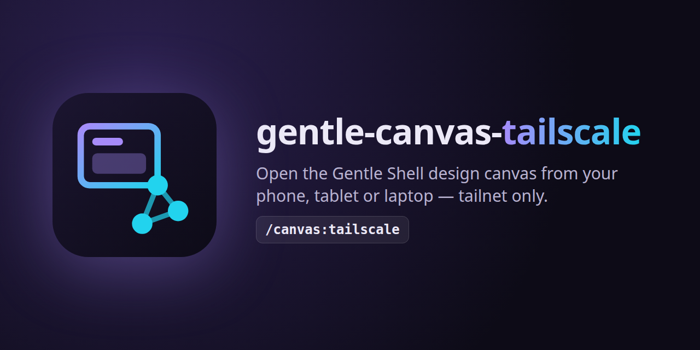

<p align="center"></p>

# gentle-canvas-tailscale

Open the [Gentle Shell](https://gentlemanprogramming.com/gentle-hub/) **design canvas** (`gentle_design` / `/gentle:design`) from your phone, tablet or another laptop — **only inside your Tailscale tailnet**.

> **Interim solution.** The canvas only accepts loopback requests today. When Gentle Shell supports remote canvas access natively, uninstall this extension.

## Why it is needed

The canvas listens on `127.0.0.1` with a random port and a random URL token on every start, and it rejects any request whose `Host` or `Origin` is not its own loopback origin. Pointing `tailscale serve` straight at it fails twice: the port changes, and the canvas answers `421 misdirected` / `403 forbidden`.

This extension runs a small loopback proxy that:

1. **Finds the canvas by itself.** The token travels in every URL path, so the proxy probes your own loopback listeners for `GET /<token>/` and accepts only the page that contains that token. It never picks another app that answers every path, nor another copy of itself.
2. **Speaks the canvas's language.** It rewrites `Host` and `Origin` to the canvas's loopback origin, drops `Referer`, and adds your tailnet origin to the artboards' `frame-ancestors`, so artboards, comments and live updates (SSE) work.

The token is still required: someone on your tailnet without the current URL gets `502`.

## Install

```bash
pi install git:github.com/BlazzzPlay/gentle-canvas-tailscale
```

Requirements: Pi with Gentle Shell (gentle-design), Node.js 22+, Linux (`ss` is used to list your loopback listeners), and Tailscale logged in on the machine running Pi.

## Set up once

Map a tailnet HTTPS port to the proxy (default `34316`):

```bash
tailscale serve --bg --https=8450 http://127.0.0.1:34316
```

`/canvas:tailscale` prints this exact command if the mapping is missing.

## Use

```text
/canvas:tailscale          start the proxy (same as: /canvas:tailscale start)
/canvas:tailscale status   show the proxy state and the current tailnet URL
/canvas:tailscale stop     stop the proxy
```

Then open a design (`gentle_design open` or `/gentle:design`). The extension starts the proxy if it is not running yet and reports both addresses at once: `/gentle:design` shows them on screen, and `gentle_design open` appends them to the tool result so the agent can hand them to you. For example:

```text
Canvas local: http://127.0.0.1:<port>/<token>/d/<design>/
Canvas on your tailnet: https://my-box.my-tailnet.ts.net:8450/<token>/d/<design>/
```

`/gentle:design` shares its URL only through its on-screen notice, so the extension watches the notices Pi shows (it reads `Design canvas: <loopback url>` and passes every notice through unchanged).

The proxy stops with the Pi session. When the canvas restarts, its token changes: open the design again to get the new URL. No restart of the proxy is needed.

### Configuration

| Variable | Default | Meaning |
| --- | --- | --- |
| `GENTLE_CANVAS_TAILSCALE_PROXY_PORT` | `34316` | Loopback port of the proxy (the `tailscale serve` target) |
| `GENTLE_CANVAS_TAILSCALE_PUBLIC_PORT` | `8450` | Tailnet HTTPS port suggested in the setup command |

The tailnet host name is read from `tailscale status --json`; the public origin is whatever `tailscale serve` maps to the proxy port.

## Security

- **Tailnet only.** The proxy deliberately bypasses the canvas's same-origin guard for your tailnet. The extension **refuses to start** when `tailscale funnel` exposes the proxy to the internet (through any serve entry, path handler or TCP forward that reaches it), and while running it re-checks every 15 seconds and **stops the proxy** if funnel is turned on later. Never put it behind funnel or any public tunnel.
- Discovery probes only your own loopback listeners, and only with the token from the request path; a tailnet client sending made-up tokens learns nothing beyond a `502`.
- The proxy listens on `127.0.0.1` only and never changes your Tailscale configuration; it only reads `tailscale status` and `tailscale serve status`.
- Anyone on your tailnet who has the current URL (with its token) can view and comment on your designs, exactly as on your own machine.

## Limitations

- The canvas's **Compare** view embeds your running app from `http://localhost:<port>`; browsers block that from an `https` tailnet page.
- Linux only for now (port listing uses `ss`).

## Develop

```bash
npm test   # node --test, no dependencies
```

## Built with Gentle-AI

<a href="https://github.com/Gentleman-Programming/gentle-ai">
  
</a>

## License

[MIT](LICENSE) © 2026 Fabian Mendoza
